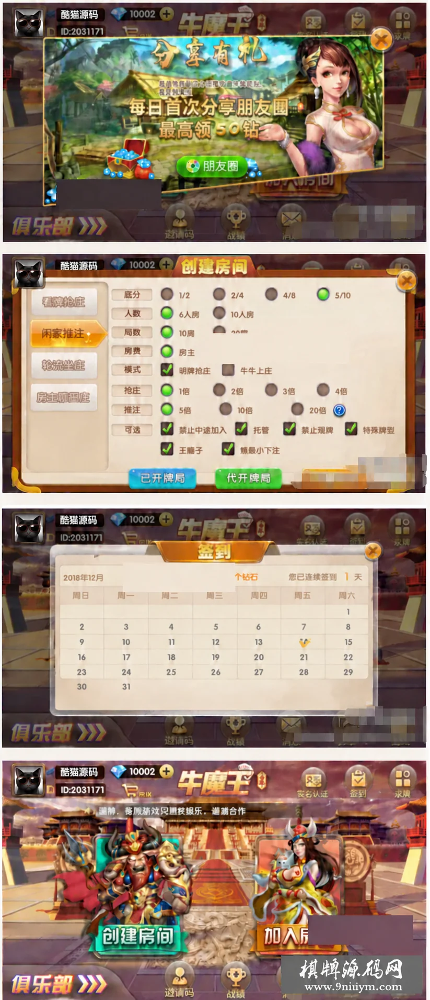

# 终极牛魔王：俱乐部入口与签到日历

终极牛魔王包含俱乐部、房卡及扫雷模式。它是多模式版本，不能仅凭房卡分类将整个项目描述成单一玩法。大厅围绕创建房间、加入房间组织操作，底部有俱乐部、邀请码、战绩和消息入口。

## 界面组成

配图依次展示分享弹窗、创建房间、签到日历和大厅。开房面板包含看牌抢庄、闲家推注、轮流坐庄和房主固定庄等选项，以及人数、局数和其他规则开关。图中的底分、抢庄与下注参数仍按原界面保留，本文不提供交易、下注或运营教程。

签到采用月历形式：年月标题与星期行确定位置，具体日期格显示签到状态。实现此类界面时，月份长度、首日星期和签到数据应分开处理，避免把上个月的标记带入新月份。

## 独立示例：生成月历格子

下面是自行编写的纯日期示例，不是原游戏代码，不涉及奖励发放。用UTC日期计算避免运行环境时区改变首日星期。

~~~js
import { monthCells } from './calendar.mjs';
const cells = monthCells(2024, 2);
console.log(cells.filter(x => x !== null).length); // 29
~~~

[calendar.mjs](calendar.mjs)以周日为每周第一天，使用null补齐月初和月末的空格。返回长度始终是7的倍数，日期从1连续递增。年份范围明确限定在1900—9999，月份限定在1—12，非法输入直接拒绝。

签到状态应以完整日期键保存，例如2024-02-01，而不是只保存日期数字1。切换月份时重新组合日期与状态；真实奖励与防重复领取需要独立的服务端逻辑，本示例不实现这部分功能。

运行 node test.mjs 执行[10项断言](test.mjs)，覆盖平年与闰年、世纪闰年规则、星期对齐、末尾补位及非法输入。

## 配图与交流

配图为第三方四联界面，账号替换为演示头像、昵称和ID，原网站标识及已有遮挡保持。仓库仅含文章与独立日历示例，不含第三方工程。

技术交流：[Telegram](https://t.me/root4433)
